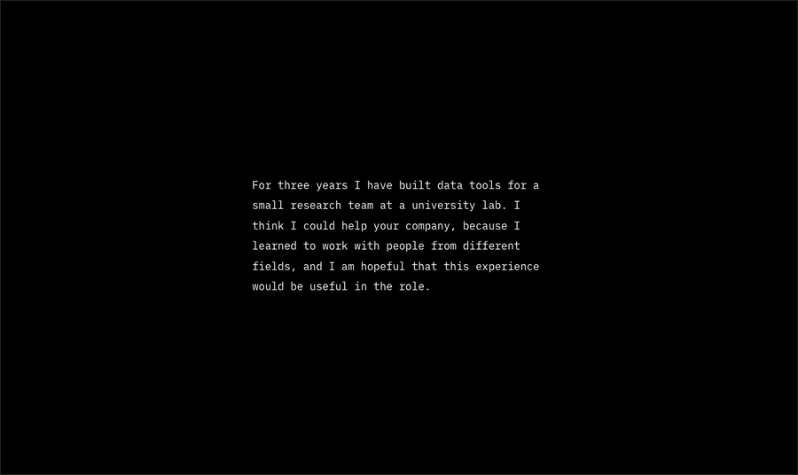
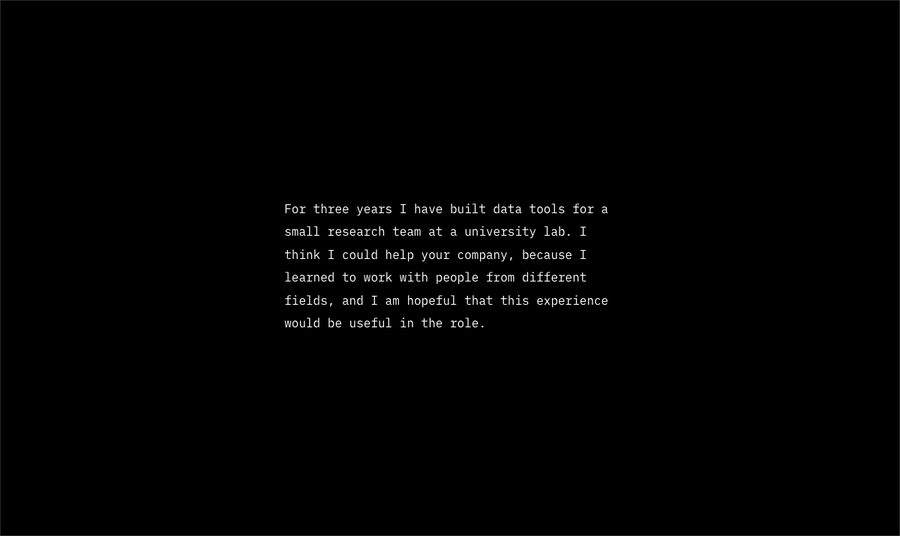
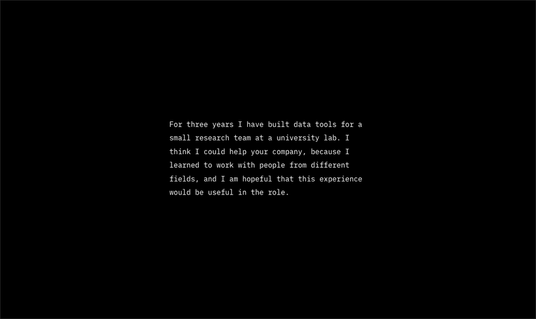

# feel

See what you would get before you ask for it.

Working with a language model on a text usually goes like this: you describe what you want, read the answer, find it is not quite right, describe it again, and repeat. Most of the effort goes into making the model understand you.

feel turns that around. Models are now fast enough to answer while your hand is still moving, so the interface shows you the versions of your text instead of asking you to describe one. You select some words, a ring opens around the screen, and the passage changes as you move across it. You stop explaining what is right and what is wrong. You look, and you choose a direction.

## Why

Text written with a model is often close to what you meant, but the feeling is off. Other people can tell, and so can you: it does not read as yours. Fixing that with prompts is slow, because a feeling is hard to put into a prompt and easy to recognise when you see it.

So every interaction here follows one rule: you see the change live, on your own text, and you steer by looking. Together they are meant to be one way of working with a model, not a set of separate tools.

## What you can do

### Change the feeling, and combine


Select some words and the ring opens with six meanings for that passage. Move toward one and the passage is rewritten as you go; the nearer the edge, the stronger the change. Only the words that changed are highlighted, so you can see exactly what each direction does.

Often one meaning is not enough: you want it warmer and also more direct. Click to pin a meaning and keep moving. Up to four combine, and the text shows the combination. Click a pin to remove it. Scroll for a new set of meanings, or back to an earlier one.

### Ask in your own words



Sometimes none of the options is where you want to go. Then just type it. The passage follows your request, and the ring fills with options close to what you asked.

A typed request rarely gives exactly the sentence you had in mind, which is the problem this project started from. So the ring stays: you ask once, then adjust the result by feeling until it is yours. Shift+Enter changes only the ring's options and leaves the text alone.

### Make it shorter


Models use a lot of words. An idea often needs far fewer. Press ← or ↓ to cut the passage while it keeps its meaning, and → or ↑ to bring words back. Tap fast to cut more. You watch the words leave, so you can stop at the length that still says what you meant.

### Use your documents



Sometimes the text needs a fact that lives somewhere else. Push the cursor to the right edge and your documents slide out. Click a passage and it is pinned like a meaning: the text brings in what it says, and it combines with whatever direction you aim at. You point at the source instead of explaining where it is and what to take from it.

### Write something new



Click between words instead of selecting them. The ring now offers moves, such as giving an example or adding a result, and the distance decides how much is written: a phrase, a sentence or a paragraph. It is the same gesture as everything else, used on text that does not exist yet.

### Keys

| Key | What it does |
| --- | --- |
| Enter / Esc | Save the change, or cancel it |
| Cmd+Z / Shift+Cmd+Z | Undo or redo a saved change |
| ← ↓ / → ↑ | Shorter, or back (while nothing is typed) |
| Scroll | New meanings, or back to earlier ones |

## Why it feels fast

Seeing the change live only works if the answer is there when the cursor arrives. Two things make that possible.

The model runs on [Cerebras](https://cloud.cerebras.ai), which answers fast enough to keep up with a moving hand.

The interface also asks ahead of need, in the way [Spaceship](https://github.com/chuanqisun/spaceship) does. When you select a passage it requests the meanings at every strength, the shorter versions, and the next set of meanings. Each time you pin something, it requests what every further move would give. Replies are remembered by exact request, so asking early and asking for real share one call.

## Run it locally

You need [Node.js](https://nodejs.org) 18 or newer and git. There is nothing to install and no build step.

1. Get the code:

   ```bash
   git clone https://github.com/EDEN757/feel.git
   cd feel
   ```

2. Start it:

   ```bash
   npm start
   ```

3. Open http://localhost:4317 in a desktop browser.

The front page shows the same five clips as above, each the real app playing itself on sample text. **try it** opens the app on a sample letter in demo mode.

To stop it, press Ctrl+C in the terminal. For another port, run `PORT=5000 npm start`.

`npm start` only serves the files. There is no backend, so any static file server works too, for example `python3 -m http.server` in this folder. Opening `index.html` straight from disk does not work, because browsers only load JavaScript modules over http.

### Demo and live

The app has two modes, shown in the top bar.

- **demo** is where it starts: pre-written answers that only fit the sample letter. It needs no key and is enough to try every interaction.
- **live** sends your text to a real model. Click **mode: demo**, choose **live**, paste your own [Cerebras](https://cloud.cerebras.ai) API key and pick a model: `gpt-oss-120b` (the default) or `qwen-3.8-27b`.

For your own text, click **edit text** and paste it in.

The key is stored only in your browser (localStorage) and sent only to `api.cerebras.ai`, straight from your browser. It never passes through a server of this project, because there is none. **forget the key** in the same dialog deletes it. What the model is asked, word for word, is in [src/llm/prompts.js](src/llm/prompts.js).

## Layout

```
index.html, styles.css   the page
src/app.js               the writing surface: the passage, aiming, pins, asking, saving
src/ring.js              the ring: its geometry, and everything drawn on the canvas
src/shorten.js           shorter with the arrow keys
src/panel.js             the documents panel
src/key.js               the mode dialog: demo or live, key and model
src/dom.js               small page helpers
src/landing.js           the front page: dot-matrix names, the falling title, the clips
src/autopilot.js         the clips: a ghost cursor playing one interaction each
src/documents.js         your reference documents, kept in the browser
src/diff.js, sound.js    word-level diff; synthesized sounds
src/sample.js            the sample letter and placeholder documents
src/llm/index.js         one door to the model: cache, queue, key storage
src/llm/prompts.js       what the model is asked, per request kind
src/llm/cerebras.js      the Cerebras client
src/llm/simulator.js     canned replies for running without a key
scripts/serve.mjs        static server for local development
tests/                   run with `npm test`
```

## Status

A prototype. Your text and documents are kept in your browser. The prompts are still being tuned against real models, and it expects a mouse, a keyboard and a wide window.

## License

[MIT](LICENSE)

## Credits

Made by [Edoardo Schiatti](https://github.com/EDEN757).

Inspired by [Spaceship IDE](https://github.com/chuanqisun/spaceship) by Chuanqi Sun.
