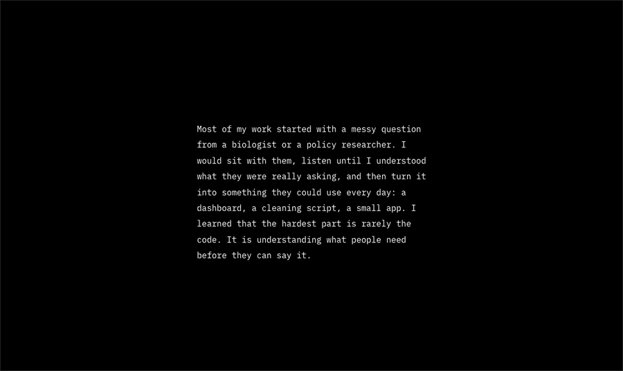

# feel

See the change before you ask for it.

## Idea

A UX research project on a new way for people and LLMs to work together, one that takes advantage of how fast models have become at answering.

You don't describe what you want. You see the versions of your text and choose a direction.

1. **Change the feeling**: select words and move across the ring. The passage changes as you move, and stronger toward the edge. Click to combine meanings.

   

2. **Ask in your own words**: when no option fits, type it. Then adjust the result on the ring until it reads as yours.

   

3. **Make it shorter**: cut words and keep the meaning. ← cuts, → brings words back.

   

4. **Use your documents**: need a fact from somewhere else? Point at it instead of explaining it.

   

5. **Write something new**: click between words. Distance decides how much is written.

   

Enter saves, Esc cancels, Cmd+Z undoes, and scrolling gives new meanings.

## Speed

It runs on [Cerebras](https://cloud.cerebras.ai), one of the few providers already serving models at this speed.

## Run it locally

You need [Node.js](https://nodejs.org) 18 or newer. There is nothing to install.

```bash
git clone https://github.com/EDEN757/feel.git
cd feel
npm start
```

Open http://localhost:4317 in a desktop browser.

It starts in **demo** mode: pre-written answers that only fit the sample letter. For a real model on your own text, click **mode: demo**, choose **live**, and paste your own Cerebras API key. The key stays in your browser and is sent only to Cerebras.

## Layout

```
index.html, styles.css   the page
src/app.js               the writing surface: the passage, aiming, pins, asking, saving
src/ring.js              the ring: its geometry, and everything drawn on the canvas
src/shorten.js           shorter with the arrow keys
src/panel.js             the documents panel
src/key.js               the mode dialog: demo or live, key and model
src/dom.js               small page helpers
src/landing.js           the front page: dot-matrix names, the falling title, the clips
src/autopilot.js         the clips: a ghost cursor playing one interaction each
src/documents.js         your reference documents, kept in the browser
src/diff.js, sound.js    word-level diff; synthesized sounds
src/sample.js            the sample letter and placeholder documents
src/llm/index.js         one door to the model: cache, queue, key storage
src/llm/prompts.js       what the model is asked, per request kind
src/llm/cerebras.js      the Cerebras client
src/llm/simulator.js     canned replies for running without a key
scripts/serve.mjs        static server for local development
tests/                   run with `npm test`
```

## License

[MIT](LICENSE)

## Credits

Made by [Edoardo Schiatti](https://github.com/EDEN757).

Inspired by [Spaceship IDE](https://github.com/chuanqisun/spaceship) by Chuanqi Sun, and by my need to write better cover letters.
